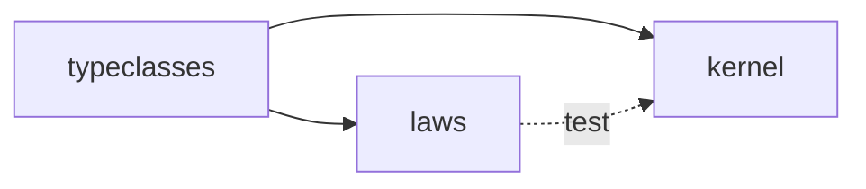

# M1 — the law checker

A property-based testing tool, and the law suites built on it. Every later test
in `laws` and `kernel` uses it. M2 is accepted only when `Monad[IO]` passes
these suites, so M1 has to be done before chapter 08 ends.

Scope and acceptance criteria: [CURRICULUM.md](../../CURRICULUM.md#m1--the-law-checker).
This document turns them into decisions. The decisions with alternatives worth
remembering are in [`decisions/`](decisions/); this document links to them
instead of repeating them.

Status: **draft**, 2026-10-28. M1 starts after chapter 06, not after
chapter 02 as planned. The delay helps: `State` (chapter 03) is the shape of
`Gen`, and the lazy structures of chapter 04 are what a shrink tree needs.

## The problem

Chapters 01 and 02 check laws with `forAllSamples` on hand-picked samples, and
both chapters end on how that fails. A functor that reverses its list passes
the identity law on every palindrome. A `List` `ap` with its loops swapped
passes every applicative law and fails only the agreement with `flatMap`, on
samples with at least two functions and two values. Hand-picked samples see
only the bugs someone thought to fear.

The checker replaces the picking: it generates many samples, and when one
fails, it reduces the failing sample to a minimal one before reporting it. A
report that says `List(0, 1)` explains the bug. A report that says a
40-element list does not.

## Modules



- **`modules/typeclasses`**, package `typeclasses`: `Eq`, `Semigroup`,
  `Monoid`, `Functor`, `Applicative`, `Monad`, `Foldable`, `Traverse`, and
  their instances for the standard types the suites are tested against
  (`Int`, `Option`, `Either[E, *]`, `List`). One hierarchy for the whole
  kernel. See [ADR 0001](decisions/0001-a-typeclasses-module.md), and
  [ADR 0007](decisions/0007-one-instance-per-type.md) for where the
  instances live.
- **`modules/laws`**, package `laws`: generators, shrinking, the runner,
  and the law suites. Its main sources depend on `typeclasses` only. No munit
  either: the curriculum allows munit only in tests.
- **`modules/kernel`** depends on `typeclasses` for compile and on `laws` for
  test.

Like `laws` and `kernel`, `typeclasses` is written by Thiago only, except the
tests and Scaladoc (see
[ADR 0006](decisions/0006-tests-and-scaladoc-in-the-milestones.md)). The build
change (a new project, `verify`, and the table in `CLAUDE.md`) comes first, on
this branch.

## The types

These are the shapes and the promises. The signatures are a starting point,
not a contract: the code may find better ones, and a change of shape gets a
line in the decisions.

### Seed

A pure, splittable pseudo-random generator: `next` gives a value and a new
seed, and `split` gives two seeds whose streams are independent. SplitMix64
does both in a few lines, with good statistical quality.

Splitting is needed, not optional. In `ga.flatMap(f)`, `ga` and `f(a)` each
get their own half of the seed. When the shrinker replaces `a` with a smaller
`a'`, `f(a')` is generated from the *same* half that `f(a)` was. With one
threaded seed, the second half would depend on how many random numbers `ga`
consumed, and a smaller `a` would change everything after it.

### Size

A non-negative `Int`, as an opaque type with a smart constructor. Generators
of collections use it as their upper bound. The runner raises it from 0 to
`maxSize` over the run, so the first tests are small and the empty cases are
tried early.

### Tree

```scala
final case class Tree[A](value: A, shrinks: LazyList[Tree[A]])
```

A value and its smaller candidates, each with its own candidates. The tree is
lazy because it is infinite in practice, and the shrinker walks one path
through it. It is a monad, and `Gen`'s monad is built on it. See
[ADR 0003](decisions/0003-integrated-shrinking.md).

**Why `LazyList`.** It is lazy per element: looking for the first candidate
that still fails computes the candidates up to that one and no further. An
`Eval[List[Tree[A]]]` would build every sibling at once, the thousand
one-element-shorter lists of a thousand-element list included, and getting
laziness per element from `Eval` means writing a stream on top of it, which is
`LazyList` again. `LazyList` is also in the standard library, while chapter
04's `Eval` lives in `solutions`, which `laws` cannot depend on. Its
memoization neither helps nor hurts: the shrinker visits each node once.
Decided 2026-10-30.

**Trap.** `Tree`'s `==` is not usable: on `LazyList` it forces both trees
whole, and a tree from a generator is infinite in practice. Trees are compared
down to a bounded depth. Likewise `LazyList(a, b, c)` evaluates its arguments
at once; candidates are built with `#::`, `unfold` or `map` over a lazy source.

**Promise.** Every value in a generator's tree is a value the generator could
have produced. `choose(10, 20)` never shrinks to 0. This promise is what
integrated shrinking buys, and the tests check it.

### Gen

```scala
final case class Gen[A](run: (Seed, Size) => Tree[A])
```

A pure function of the seed and the size. That is `State[Seed, A]` from
chapter 03 with a size beside it and a tree around the result, but written
directly: `laws` does not depend on the course's `State`. `map` and `flatMap`
are member methods, so for-comprehensions work on `Gen`
([ADR 0009](decisions/0009-gen-syntax-as-member-methods.md)).

**Promises.** Deterministic: the same seed and size give the same tree.
Lawful in distribution: `flatMap` splits the seed, so the monad laws cannot
hold seed by seed, and they are checked on histograms over fixed seeds; the
functor laws do hold seed by seed. Independent: the two sides of `flatMap`
draw uncorrelated numbers. See
[ADR 0010](decisions/0010-gen-is-lawful-in-distribution.md). The checker
checks its own generator, which previews how M2 compares two `IO`s.

The primitive generators are the ones the suites need, and no more: `const`,
`choose(lo, hi)` for `Int` (shrinks toward the bound nearest to 0), `bool`,
`oneOf`, `frequency`, `listOf` (shrinks by dropping elements, then by shrinking
them), `option`, `either`, and `fun` (below).

### Fun

```scala
final case class Fun[A, B](table: Map[A, B], default: B):
  def apply(a: A): B = table.getOrElse(a, default)
```

A generated function, as a finite table plus a default. It prints as
`{1 -> [2, 3], 2 -> [], _ -> [5]}`, and it shrinks by dropping entries, then
by shrinking keys and values. See
[ADR 0005](decisions/0005-functions-as-finite-tables.md).

### Eq

```scala
trait Eq[A]:
  def eqv(x: A, y: A): Boolean
```

What the suites compare with, never `==`. It lives in `typeclasses`, since the
kernel will compare tables with it. An instance for a structure that may be
infinite compares a prefix, and says how long. See
[ADR 0004](decisions/0004-equality-as-a-typeclass.md).

### Law

```scala
final case class Law[A](lhs: A, rhs: A)
```

A law is an equation, not a `Boolean`. The checker compares the two sides with
`Eq` and, when they differ, reports both. "Associativity failed" says that
something is wrong. The two sides say what.

### Prop, the runner and the report

A property is a generator of inputs and a function from an input to a `Law`
(or to a `Boolean`, for properties that are not equations). An exception the
function throws is a failure like any other, and its input is shrunk the same
way.

`check(prop, config)` returns a value, not an assertion:

```scala
enum Result:
  case Passed(tests: Int)
  case Failed(report: Report)
```

A `Report` holds what is needed to understand and reproduce the failure: the
seed and size of the failing test, the test's number, the original
counter-example, the shrunk one, both sides of the law at the shrunk one, and
the number of shrink steps taken.

`Config` holds the number of tests (default 100), `maxSize` (default 30), the
seed (random unless given, so a reported seed reproduces the run), and a limit
on shrink steps (default 1000), so a bad shrink tree cannot hang a test run.

**Shrinking** is greedy: from the failing node, take the first candidate that
still fails, and repeat until none does or the limit is reached. Greedy does
not always find the global minimum, but it is predictable, and the order of
candidates (most aggressive first: the origin, then halves) gets close in
practice.

## The law suites

A suite is a name, its parent suites, and a list of named properties. `Monad`
includes `Applicative`, which includes `Functor`, so checking `Monad[Option]`
checks all three, and a report names the law that failed.

The element types are fixed at `Int` and the functions at `Fun[Int, Int]` (or
`Fun[Int, F[Int]]`). For a law over any `A`, parametricity means the instance
cannot behave differently on `Int` than elsewhere (chapter 01, exercise 04).
`Int` with distinct values is enough to see order and duplication.

| suite | laws |
| --- | --- |
| Semigroup | associativity |
| Monoid | left identity, right identity |
| Functor | identity, composition |
| Applicative | identity, homomorphism, interchange, composition; `map` agrees with `pure(f).ap` |
| Monad | left identity, right identity, associativity; `ap` agrees with `flatMap` |
| Traverse | identity (`traverse` in `Id` is `map`), composition (in `Nested[Option, List]`), naturality restricted to `Option → List`; `foldLeft` agrees with `traverse` in `Const` |

What a suite asks for is the instance, plus `Gen` and `Eq` for each type it
quantifies over: `Gen[F[Int]]`, `Eq[F[Int]]`, and for `Traverse`, `Eq` of the
composed results.

`Id`, `Const` and `Nested` are used by the Traverse suite only, so they live in
`laws`, not in `typeclasses`. Chapter 09 makes `Const` the subject of a chapter.
Here it is just a helper.

## Boundaries

- **`laws` returns values; tests assert.** `check` returns a `Result`. A
  test-side helper turns `Failed(report)` into an munit failure whose message
  is the report. That helper is written once in `laws`' tests and once in
  `kernel`'s, which do not share test code. It is a few lines.
- **No reflection, no macros.** A suite is ordinary values and functions.
- **Printing is `toString`.** No `Show` typeclass in M1. `Fun` and the test
  fixtures override `toString` where the default is unreadable. If `toString`
  turns out not to be enough, a `Show` belongs in `typeclasses` and gets its
  own decision.

## Out of scope

- A general `Cogen` (functions from any input type). Tables cover `Int` and
  any type with usable equality, which is all M1 needs.
- Filtering (`suchThat`) and the "gave up" result it would need. A generator
  that produces only valid values is always better, and nothing here needs
  one.
- Stateful and model-based testing. M4 may want it, and its design decides.
- Shrinking through `flatMap` without regenerating. The limitation is
  described in ADR 0003.

## Test plan

The tests of `laws` itself, written alongside the code:

- **Seed.** `split` halves differ from each other and from the parent. Neither
  `next` nor `split` mutates anything (a reused seed gives the same value).
- **Determinism.** For every primitive generator, the same seed and size give
  the same tree, compared to a fixed depth.
- **Shrink promises.** `choose(lo, hi)` shrinks stay in range, including
  ranges that exclude 0 and ranges at `Int.MinValue` and `Int.MaxValue`, where
  "halve the distance" overflows if written naively. `listOf` shrinks are
  sublists of the original. `Fun` shrinks are tables with fewer entries or
  smaller keys and values.
- **Shrinking finds the edge.** `x < 100` over `choose(0, 1000)` shrinks to
  exactly `100`. `xs.sum < 10` shrinks to a list whose sum is exactly 10.
- **Reproducibility.** Running again with a report's seed and size gives the
  same failing input.
- **Gen is a monad in distribution.** The functor laws hold seed by seed,
  the monad laws in distribution, and the two sides of `flatMap` are
  independent (ADR 0010).
- **Each suite discriminates.** It passes a lawful instance and fails an
  unlawful one, with the failure reported against the right law.

### Acceptance

The unlawful instances of chapters 01 and 02, recreated as fixtures in
`laws`' tests against `typeclasses` (see
[ADR 0002](decisions/0002-fixtures-for-the-unlawful-instances.md)). Each must
fail the named law, with a shrunk counter-example of the shape shown.

| from | instance | fails | shrunk counter-example |
| --- | --- | --- | --- |
| — | `Semigroup[Int]` by subtraction | associativity | `a = 0, b = 0, c = ±1` |
| ch01 pitfalls | `Monoid[Int]` with `*` and `empty = 0` | left identity | `a = ±1` |
| ch01 ex 04 | `Functor[List]` that reverses | identity | two distinct elements, one of them 0 |
| ch02 ex 01 | `Monad[Either[Int, *]]` whose `ap` keeps the value's `Left` | `ap` agrees with `flatMap` | `Left(0)` and `Left(±1)` |
| ch02 ex 01 | `Monad[List]` whose `ap` swaps the loops | `ap` agrees with `flatMap` | two functions, two values |
| ch02 ex 04 | `Applicative[ZipList]` with a one-element `pure` | identity | a `ZipList` of two elements |
| ch02 ex 04 | `ZipList` with `diagonal` as `flatMap` | associativity | `m` of two elements |
| — | `Traverse[List]` that drops the last element | identity | a one-element list |

Only the first two columns are fixed. The shrunk shapes are what a good shrink
should reach. If one of them turns out unreachable with greedy shrinking, the
test asserts what is reached, and the gap goes in the decisions.

The ZipList fixtures compare with a prefix `Eq`. The bound is above `maxSize`,
so every finite list generated is compared whole (ADR 0004).

M1 is done when all of this is green under `sbt verify`. The branch,
`milestone-01`, is then merged with a merge commit and the merge tagged `m01`.

## Open questions

None at the moment.

