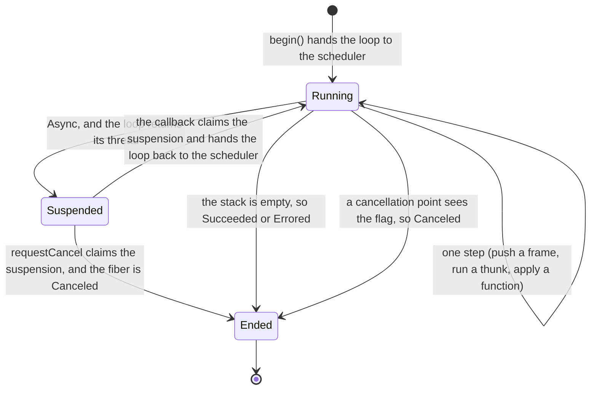
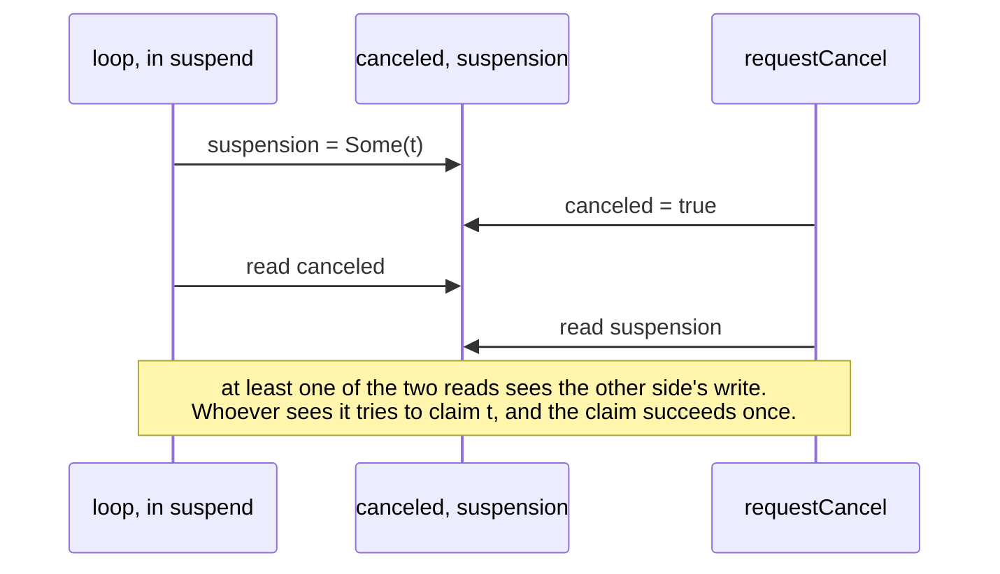
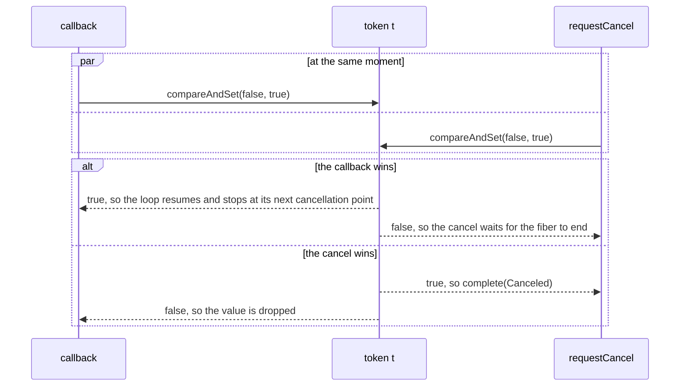

# Chapter 06 — Fibers and schedulers

## Why this exists

Chapter 05's `IO` runs one thing at a time, on the thread that called
`unsafeRun()`. A pipeline wants more than that almost at once: read two
tables at the same time, take whichever of two sources answers first, give up
on a read that takes longer than a minute. None of those can be described with
`flatMap`, which runs its second program only after the first has finished.

The JVM has threads, and every one of those is a few lines with them — but
each line costs something the type does not show.

```scala
val t = Thread(() => readTable("a"))
t.start()           // runs now, not when the program runs
t.join()            // this thread does nothing until t is done
```

`start()` is an effect performed where it is written, so the program is no
longer a description: chapter 05's refactorings are back to being unsafe. The
`join()` holds a whole OS thread — a megabyte of stack and a slot in the
kernel's scheduler — to do nothing, and a program that waits on a hundred
reads holds a hundred of them. And there is no way to *stop* `t`:
`Thread.stop` is gone from the JDK, and `interrupt()` only reaches code that
happens to be waiting on something that checks for it. A `Future` fixes the
waiting but not the rest: it starts the moment it is built, and it cannot be
canceled at all.

A timeout makes the last point concrete. "Read this table, or fail after a
minute" needs two things to run at once — the read and a clock — and, when
the clock wins, the read must *stop*: a timeout that leaves the read running
has only stopped waiting for it, and the read goes on holding its thread, its
connection and its memory.

What is missing is concurrency as part of the description: a program that
says "run this alongside", "wait for that one", "stop that one", and a single
place that decides which threads actually run them.

## The idea

**A fiber is a running description.** `io.start` is an `IO[Fiber[A]]`: run, it
begins running `io` alongside the current program and produces a handle at
once, without waiting. The fiber is chapter 05's run loop — an `IO` and a
stack of what is left to do — on whatever thread it was given. It is cheap: a
few objects on the heap, not an OS thread. Building `io.start` runs nothing,
so the program is still a value.

**A fiber ends in one of three ways.** Its `Outcome` is `Succeeded(a)`,
`Errored(e)` or `Canceled`. Canceled is not an error: nothing failed, someone
asked the fiber to stop. Folding it into `Either[Throwable, A]` would hand it
to every error handler on the way, and a handler that recovers from
"canceled" by retrying has undone the cancel. `fiber.join` is an
`IO[Outcome[A]]`, and what to do with each of the three is the joiner's
decision.

**Waiting does not hold a thread.** A fiber that joins another, or sleeps, is
*suspended*: an `IO.async` registers a callback and the run loop returns,
handing its thread back to the scheduler. When the callback fires — the
joined fiber finished, the timer went off — the loop resumes, on whatever
thread the scheduler picks, with the same stack it had. A thousand fibers
waiting on a thousand joins hold no thread at all.

**Cancellation is cooperative.** `fiber.cancel` sets a flag and waits for the
fiber to finish. The fiber checks the flag at its *cancellation points*: before
it applies a `flatMap`'s function, and before it runs an error handler.
Between two binds the description says "here is a boundary", and that is
where it may stop — never in the middle of a `delay`, which might be halfway
through writing a file. A fiber suspended in an `async` is canceled at once,
since nothing of it is running. The price is the other half of the same fact:
a `delay` that blocks for ten seconds delays its own cancel by ten seconds.
`Thread.interrupt` takes the opposite trade, and stops code at whatever point
it happens to check — which is why so much code swallows
`InterruptedException`.

**A scheduler is where fibers run, and it is swappable.** It has one
operation, `execute(task)`, and a run loop asks for nothing else. Two
strategies sit behind it:

| scheduler | a fiber runs on | a fiber that blocks a thread |
| --- | --- | --- |
| `Scheduler.pool(n)` | one of `n` OS threads | holds one of the `n`; `n` of them stop everything |
| `Scheduler.virtual()` | a virtual thread of its own | parks it; the OS thread under it moves on |

A fiber that only suspends — joins, sleeps, `async` — behaves the same on
both. What changes is *blocking*: `Thread.sleep`, a JDBC call, a
`CountDownLatch.await` inside a `delay`. On a pool, each one holds a thread;
on virtual threads, a blocked thread costs a few hundred bytes. The same test
suite runs against both, and a test that passes only on virtual threads is a
program that blocks where it should suspend.

**`race` runs two programs and cancels the loser.** `IO.racePair(a, b)` starts
both and produces the first outcome together with the other fiber, still
running. `race` decides what that means: the winner's value, or its error —
and in every case the loser is canceled before `race` returns, so nothing it
does is left running. `timeout` is a race against `IO.sleep`.

## Inside the runtime

The previous section says what the runtime in `IO.scala` promises. This one
says how it keeps those promises, and why that is right. It is written to be
consulted, while reading `IO.scala` now and again in milestone 2, which builds
the same runtime from an empty module. Every claim below about a race is
checked by
[`RuntimeSpec.scala`](../../modules/solutions/src/test/scala/advfp/ch06fibersandschedulers/RuntimeSpec.scala),
which forces both orders of each race a couple of thousand times, on both
schedulers.

### What a fiber holds

A fiber is chapter 05's loop plus three atomic variables. The loop's own
state — the `IO` it is running and its stack — is not shared: only the thread
running the loop touches it.

| variable | holds | written by | read by |
| --- | --- | --- | --- |
| `canceled` | `AtomicBoolean` | `requestCancel`, once, to `true` | the loop at every cancellation point, and `suspend` |
| `suspension` | `Option[AtomicBoolean]`: the token of the suspension the loop is waiting in | `suspend` (sets it), the callback (clears it) | `requestCancel` |
| `state` | `Running(waiters)` or `Ended(outcome)` | `onComplete` (adds a waiter), `complete` (ends the fiber) | `onComplete`, `complete` |

When the loop moves to another thread — a callback resumes it with
`scheduler.execute(() => loop(next, stack))` — the stack travels inside that
closure. Handing a task to an executor publishes everything written before it:
the `java.util.concurrent` package documentation lists, among its *memory
consistency properties*, that actions in a thread before it submits a
`Runnable` to an `Executor` *happen-before* that `Runnable` starts. So the new
thread sees the stack exactly as the old one left it, and nothing else is
needed.

### The three invariants

Everything rests on three facts.

1. **A fiber ends exactly once.** `complete` runs once, so every waiter is
   told once, and the outcome never changes after it is set.
2. **A suspension ends exactly once.** Either its callback resumes the loop,
   or a cancel ends the fiber in its place — never both, and never twice.
3. **A cancel is never lost.** Once `canceled` is `true`, a running fiber
   stops at its next cancellation point, and a suspended one is ended by the
   cancel itself.

Invariant 2 is what makes invariant 1 hold. A fiber can be ended in two
ways. Its running loop ends it when the stack empties or a cancellation point
sees the flag. Otherwise it is ended by claiming the token of a pending
suspension: `requestCancel` does that, and so does `suspend` itself when it
finds the flag already set. The loop only runs while no suspension is pending,
and a pending suspension's token is claimed once. So no two of them can both
end the fiber.

### The life of a fiber



A fiber spends its life alternating between *Running* (on some thread,
taking steps) and *Suspended* (on no thread at all). Each pass through
*Suspended* creates a new token, and leaving it means claiming that token.

### One program, traced

```scala
for
  _     <- where("1")                          // prints the thread it ran on
  child <- where("2").map(_ => 2).start
  _     <- where("3")
  _     <- IO.sleep(20.millis)
  _     <- where("4")
  o     <- child.join
  _     <- where("5")
yield o
```

Run on `Scheduler.pool(2)` (measured 2026-10-23), it printed steps 1 and 3 on
`pool-0`, step 2 on `pool-1`, and steps 4 and 5 on `pool-1`. The root fiber
started on one thread and finished on the other. Here is what happened:

| # | thread | what the runtime did | afterwards |
| --- | --- | --- | --- |
| 1 | `main` | `unsafeRun` registers a latch as the root fiber's first waiter, hands the loop to the pool, and blocks on the latch | root `Running([latch])` |
| 2 | `pool-0` | root: runs step 1; meets `Start`, creates the child fiber, hands its loop to the pool, and goes on at once with `Pure(child)` | child queued |
| 3 | `pool-1` | child: runs step 2, its stack empties, `complete(Succeeded(2))`: no one is waiting yet | child `Ended(Succeeded(2))` |
| 4 | `pool-0` | root: runs step 3; meets `IO.sleep`'s `Async`: creates token *t*, sets `suspension = Some(t)`, reads `canceled` (false), schedules the timer, and returns | root *Suspended*, `pool-0` free |
| 5 | `io-timer` | 20 ms later the callback claims *t*, clears `suspension`, and hands `loop(Pure(()), stack)` to the pool | root *Running*, queued |
| 6 | `pool-1` | root: runs step 4; meets `join`'s `Async`: suspends, and `register` calls `onComplete`, which finds the child `Ended` and calls back at once; the callback claims the new token and hands the loop to the pool again | root queued |
| 7 | `pool-1` | root: runs step 5, its stack empties, `complete(Succeeded(Succeeded(2)))`, which tells the latch | root `Ended` |
| 8 | `main` | the latch opens and `unsafeRun` returns `Succeeded(Succeeded(2))` | |

Steps 2 and 3 run on two threads at once, so their output can come in
either order. Step 6 shows a detail worth knowing: joining a fiber that has
already ended still suspends and resumes, so the joiner passes through the
scheduler once even though it never waits.

### The races, and how each is settled

Four races can happen, and each is settled by one atomic operation.

**A cancel against a fiber going into a suspension.** The loop is about to
suspend at the moment another fiber cancels it. Each side writes its own
variable and then reads the other's:



That *at least one sees the other* is a fact about the Java memory model, not
luck. An atomic's `get` and `set` behave as volatile reads and writes (the
`java.util.concurrent.atomic` package documentation), and volatile accesses
fall into one *synchronization order* that is total and agrees with each
thread's program order (JLS §17.4.4). Suppose the loop read `canceled` as
`false`. Then that read comes before the cancel's write in the total order.
The loop's write of `suspension` comes before its own read, so it comes
before the cancel's write too, and therefore before the cancel's read: the
cancel sees `Some(t)`. The same argument works the other way round. Both
reads may also see the other side, and then the claim on *t* decides who ends
the fiber.

Get the order wrong, or skip the loop's second read, and both sides can miss
each other. The fiber then sits in `IO.never` with no one left to end it, and
the cancel, which waits for the fiber, waits forever. Measured 2026-10-23:
a `requestCancel` that reads `suspension` before setting the flag, and a
`suspend` that does not re-read the flag, each fail the spec's
cancel-into-suspension race on both schedulers, by timeout; the reversed
order failed in three runs of three.

**A callback against a cancel, on a fiber already suspended.** Both want to
end the same suspension, and both try `compareAndSet(false, true)` on its
token:



Both endings are correct, and both happen. Over 2,000 forced rounds the
callback won 166 times on `pool(4)` and 344 times on virtual threads, and the
cancel won the rest. Measured 2026-10-23: a callback that claims with a plain
`set` instead of `compareAndSet` fails ten of the spec's sixteen tests. A cancel
that *checks* the token and then sets it was caught in only four runs out of
five, and only on virtual threads: the window between its read and its write
is a few instructions wide. A race test that passes is evidence, not proof;
the `compareAndSet` is what makes the protocol right.

**A join against the end of the fiber.** `onComplete` adds a waiter with
`compareAndSet` on `state`, and `complete` swaps in `Ended` with `getAndSet`.
A join either lands in `Running`'s list before the swap, and then `complete`
calls it, or it sees `Ended` and calls itself back. Either way it is told
exactly once. A plain `set` in `onComplete` loses updates: two joiners read
the same list, and the second write drops the first joiner, who then waits for
good. Measured 2026-10-23: eight of the spec's sixteen tests fail, in two
runs of two.

**Two fibers ending at once in `racePair`.** Both call the racer's callback.
`async` keeps the first call — it is a claim on the racer's own token, as in
the second race above — and ignores the second. Over 2,000 forced rounds each
side won some (on `pool(4)`, 44 against 1,956; on virtual threads, 411
against 1,589), and the race decided once every time.

### What it deliberately does not do

Each of these is a decision, not an oversight. Each shows up somewhere, and
together they are the starting list for milestone 2.

| it does not | where that shows |
| --- | --- |
| take a thread away from a fiber | a fiber that never suspends keeps its thread for good: the `spin` pitfall, which starves `pool(1)` |
| interrupt a running `delay` | cancel waits for the `delay` to end: about 490 ms for a `Thread.sleep(500)` |
| run anything when a fiber is canceled | a canceled fiber runs no handler, so it cannot release what it holds; chapter 08's `Resource` needs `onCancel` and uncancelable regions |
| cancel a fiber's children with it | `racePair`'s fibers outlive a racer that is canceled while it waits |
| end a fiber killed by a fatal error | the error escapes the loop and `complete` is never called. Measured 2026-10-23: a `StackOverflowError` in a `delay` kills its thread, and a fiber joining it waits until `unsafeRun` times out |
| unschedule the timer of a canceled `sleep` | the timer still fires, and its callback finds the suspension claimed and does nothing |
| hand waiters to the scheduler | waiters run on the thread that ends the fiber, one after the other; here every waiter only hands a loop to the scheduler, so none of them is slow |

## In code

The executable version of this chapter is
[`Walkthrough.scala`](../../modules/exercises/src/main/scala/advfp/ch06fibersandschedulers/Walkthrough.scala).
Read it alongside this document. It compiles with the rest of the module, so
none of it is pseudo-code, and `sbt playground/console` is where to poke at it.

The runtime the exercises use is
[`IO.scala`](../../modules/exercises/src/main/scala/advfp/ch06fibersandschedulers/IO.scala),
given: chapter 05's `IO` with `start`, `async`, cancellation and the two
schedulers added.

## Pitfalls

**A fiber that never suspends keeps its thread.** This runtime does not take
a thread away from a fiber: the fiber gives it back when it suspends or ends.
A loop of `delay`s and `flatMap`s that never waits holds its thread for good.
Measured 2026-10-23: `IO.racePair(spin, IO.pure(1))`, where `spin` counts
forever, ends at once on `pool(4)` and on virtual threads, and on `pool(1)`
never ends at all — `spin` took the only thread before `IO.pure(1)` got it:

```text
java.util.concurrent.TimeoutException: the program did not end within 2 seconds
```

Production runtimes yield on their own every so many steps (Cats Effect calls
it auto-ceding); this one leaves it to the program.

**A blocking `delay` delays its own cancel.** Cancellation waits for the next
cancellation point, and a `delay` has none inside it. Measured 2026-10-23:
canceling a fiber inside `IO.delay(Thread.sleep(500))` took 492 ms on `pool(4)`
and 490 ms on virtual threads, while canceling one inside
`IO.sleep(500.millis)` took a millisecond at most, on all three schedulers. On
`pool(1)` it was worse: the fiber that wanted to cancel could not run until
the sleeping one gave the only thread back, and by then it had finished — the
outcome was `Succeeded`, not `Canceled`. Waiting belongs in `IO.sleep` and
`async`, which suspend, not in `Thread.sleep` inside a `delay`.

**Blocking on a pool turns concurrent programs sequential.** Two `delay`s that
each wait on a latch the other one opens — the meeting in exercise 03's spec —
run concurrently with `start` and `join`. Measured 2026-10-23: on `pool(4)` and
on virtual threads both see the other, `(true, true)`; on `pool(1)` the first
blocks the only thread for its whole two-second timeout before the second
starts, `(false, true)` after 2007 ms. The program is correct; the strategy is
what changed. Suspending instead of blocking — `IO.sleep`, `join` — makes the
number of threads irrelevant: 100,000 fibers each sleeping 200 ms ended in
378 ms on `pool(1)`.

**A cancellation check where a bind is pushed checks too early.** The loop
meets a `FlatMap` before its source runs, so reading the flag there misses
every cancel the source requests — and in `a.flatMap(f).flatMap(g)` every
function is pushed before the first effect runs, so nothing is ever checked
again. Measured 2026-10-23: that loop fails five of exercise 02's eleven
tests. The check belongs where a function is *applied*.

**`both` that joins before it starts is sequential.** `a.start`, `join`,
then `b.start` pairs the same values as starting both first, and runs one
after the other. Measured 2026-10-23: exercise 03's meeting test gets
`Succeeded((false,true))` under both schedulers instead of
`Succeeded((true,true))`.

**A race that does not cancel the loser has only stopped waiting.** The
loser goes on running after the race has returned, and nobody holds its
handle any more. Measured 2026-10-23: a `race` that returns the winner
without canceling fails four of exercise 04's ten tests under each scheduler —
the loser's counter keeps climbing, and the effect it was sleeping towards,
"too late", is written after the race has ended.

**A fiber left running by a wrong answer keeps running inside sbt.** Tests run
in sbt's own JVM, and a fiber nobody canceled is still spinning there when the
suite ends. Measured 2026-10-23, while writing this chapter: after a few runs
of a `race` that did not cancel its loser, the sbt server sat at 537% CPU. The
specs' spinning programs now stop when their scheduler is shut down, but a
fiber of your own may not: if the machine stays busy after a red run,
`sbt --client shutdown` and start again.

## Exercises

| # | asks for |
| --- | --- |
| 01 | `Scheduler.pool(n)` and `Scheduler.virtual()` behind one interface, and the contract both must keep |
| 02 | a run loop that ends in an `Outcome`, with cancellation points between binds and before handlers |
| 03 | `joinValue`, and `both`: two programs run concurrently, the first error canceling the other |
| 04 | `race`, which cancels the loser, and `timeout` on top of it |

```bash
sbt "exercises/testOnly advfp.ch06fibersandschedulers.*"
```

## Further reading

- Simon Marlow, Simon Peyton Jones, Andrew Moran and John Reppy,
  *Asynchronous Exceptions in Haskell*, PLDI 2001 — cancellation as a
  first-class outcome, and why where it may happen has to be controlled.
- Simon Marlow, *Parallel and Concurrent Programming in Haskell*, O'Reilly
  2013, chapters 8 and 9 — `async`, `wait`, `race` and cancellation, built
  from a handful of primitives.
- JEP 444, *Virtual Threads* (openjdk.org/jeps/444) — what a virtual thread
  is, what blocking one costs, and how it is mounted on a carrier thread.
- The Cats Effect source, `core/shared/src/main/scala/cats/effect/IOFiber.scala`
  in typelevel/cats-effect — the production fiber: the same loop, with
  `async`, cancellation, finalizers and automatic yielding.
