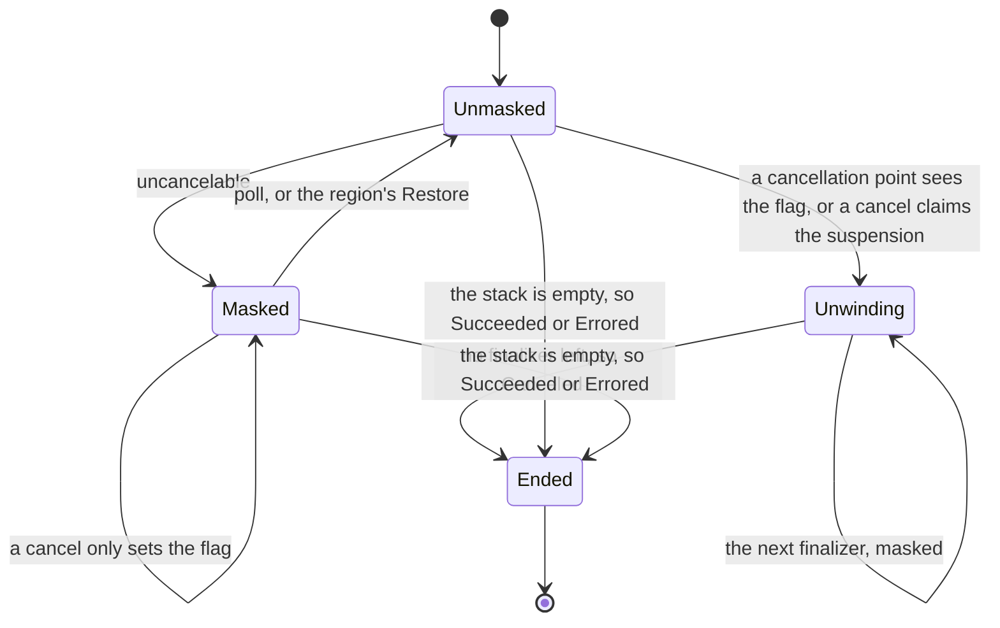
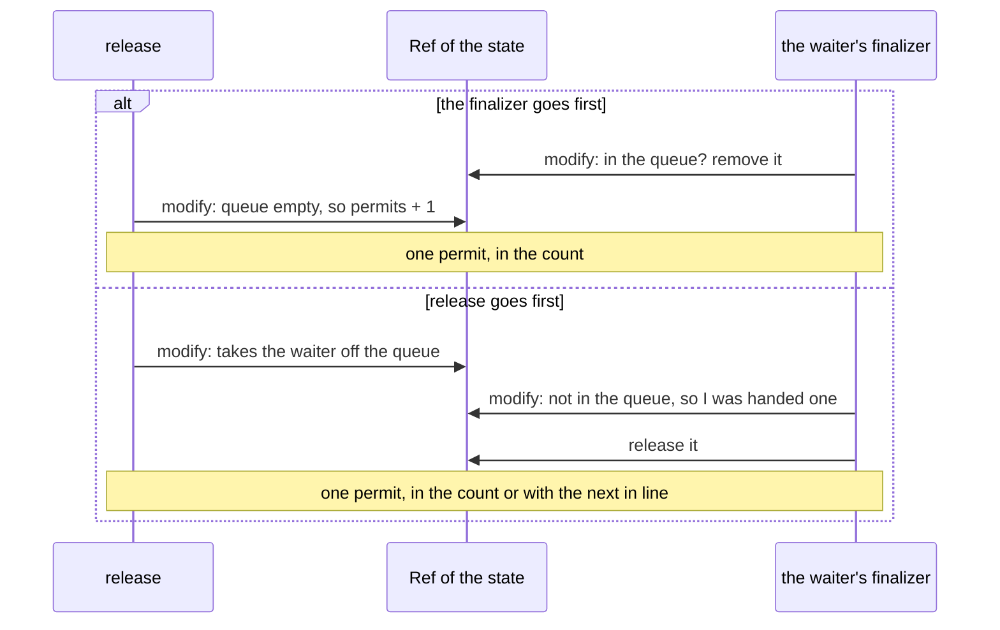

# Chapter 07 — Concurrent primitives

## Why this exists

Chapter 06's fibers can start each other, wait for each other's end, and cancel
each other. They cannot talk. A pipeline that reads eight tables at once wants
more than that almost at once: count the rows they have read so far, let no more
than four of them hold a connection, tell the writer that the schema has been
loaded, stop a fast reader from filling memory faster than a slow writer empties
it. None of those is about a fiber *ending*.

The JVM has an answer to each, and each costs something the type does not show.

```scala
var rows = 0
val count = IO.delay(rows += 1)                 // two fibers lose updates

val permits = java.util.concurrent.Semaphore(4)
val read = IO.delay(permits.acquire()).flatMap(_ => readTable)
```

The `var` loses updates, since `+=` reads and then writes. `AtomicInteger` fixes
that for one number, but not for "the count and the largest table so far",
updated together. The `Semaphore` keeps its promise, and pays for it with a
thread: `acquire()` blocks, so on `Scheduler.pool(1)` the first fiber to wait
stops every other fiber, including the one that would have called `release()`.
It cannot be canceled either: chapter 06's cancel waits for a `delay` to end, and
this one ends when someone releases. And a fiber canceled after `acquire()` still
holds its permit, with nobody left to give it back.

What is missing is shared state and signalling as part of the description: state
that several fibers change without losing an update, a way of waiting that holds
no thread and can be canceled, and a guarantee that a canceled fiber gives back
what it holds.

## The idea

**Two primitives are enough.** `Ref[A]` is a shared cell that changes atomically.
`Deferred[A]` is a value that arrives once: readers suspend until it does. A
`Ref` holds state and cannot wait; a `Deferred` can wait and holds no state worth
speaking of. Everything else in this chapter is the two together.

**`Ref` retries instead of locking.** `update(f)` reads the current value,
computes `f(value)`, and writes it with `compareAndSet` only if the cell still
holds what it read. If another fiber got there first it reads again and tries
again. No fiber ever waits for another: one always gets through, and the loser
repeats a little work. The price is that `f` may run more than once, so it must
be a pure function: a `println` inside it prints once per attempt.

`modify` is the one to reach for. `modify(f)`, with `f: A => (A, B)`, changes the
cell and produces a `B` computed from the same read, and that is the whole
difference between it and `get` followed by `set`, where another fiber can run in
between.

**`Deferred` suspends instead of blocking.** `get` is an `IO.async` that leaves
its callback in the `Deferred`. `complete(a)` fills it, once, and calls every
callback left there, so a thousand fibers waiting hold no thread at all.
`complete` produces whether it was the one that filled it: the second call
changes nothing and says so.

**A primitive is a state machine in a `Ref`, with its waiters as `Deferred`s.**
The shape is always the same. A fiber makes a `Deferred` of its own and calls
`modify` once. In that one atomic step it decides from the state what to do, and
the step produces the rest of the program as a value:

```scala
state.modify:
  case State(0, waiters) => (State(0, waiters.enqueue(mine)), mine.get) // wait
  case State(n, waiters) => (State(n - 1, waiters), IO.unit)            // go on
.flatMap(identity)
```

The state changes in the `modify`; the waiting and the waking happen afterwards,
outside it. `f` may run more than once, so it cannot wait or wake anything itself:
it can only *describe* what to do, and the attempt that succeeds is the one whose
description runs. That is what makes the state consistent without a lock.

**Cancellation needs a region and a finalizer.** A fiber waiting in `mine.get` is
in the queue. Cancel it there and it never takes the permit `release` hands it,
so that permit is gone, and every fiber behind it waits for good. A `Semaphore`
needs to run code on the way out. This chapter's `IO` adds what is needed for it:

- `io.onCancel(finalizer)` runs `finalizer` if the fiber is canceled while `io`
  runs. Not on success, and not on an error.
- `IO.uncancelable(poll => body)` runs `body` with cancellation turned off: a
  cancel requested inside waits until the region has ended. `poll(io)` turns it
  back on for `io`, which is where the waiting goes.

Between the `modify` that joins the queue and the `get` that waits there is a
bind, and a bind is a cancellation point. Without `uncancelable`, a cancel landing
there leaves a fiber in the queue that is no longer waiting. With it, the region
has exactly one place where the fiber may stop, and that place has a finalizer:

```scala
IO.uncancelable: poll =>
  state.modify:
    case State(0, waiters) => (.., poll(mine.get).onCancel(leaveTheQueue(mine)))
    case ...
  .flatMap(identity)
```

**A hand-off closes the door on barging.** `release` with a fiber waiting does not
add a permit. It gives its permit directly to the first in the queue, so the
count never rises and a fiber arriving now finds none and queues behind. A
version that adds a permit and wakes someone is simpler, and a fast fiber can
overtake the waiter forever.

**Back-pressure is the same machine with two queues.** A bounded `Queue` holds up
to `capacity` values. `offer` on a full queue waits, and that is the whole point:
a producer that outruns its consumer is slowed down by it instead of filling
memory. `take` on an empty queue waits too. Both wait as above, with a `Deferred`
of their own in the state.

## Inside the regions

The previous section says what `uncancelable`, `poll` and `onCancel` promise. This
one says how the runtime in `IO.scala` keeps that, on top of chapter 06's "Inside
the runtime", whose invariants and races all still hold. It is written to be
consulted, now and again in milestone 2. Every claim below about a race is checked
by
[`RuntimeSpec.scala`](../../modules/solutions/src/test/scala/advfp/ch07concurrentprimitives/RuntimeSpec.scala),
which also runs all of chapter 06's races against the new loop.

### What the loop gained

One argument and three frames. The loop now takes `masked`, a `Boolean`. Only the
loop reads or writes it, so it needs no atomic; it travels with the stack, through
the closure that resumes a suspended fiber.

| frame | pushed by | when a value or an error reaches it |
| --- | --- | --- |
| `Finalize(finalizer, rest)` | `onCancel` | it is popped, and the finalizer never runs |
| `Restore(masked, rest)` | `uncancelable` and `poll` | the mask goes back to what the frame holds |
| `Unwind(rest)` | a cancel | whatever arrived is dropped, and the next finalizer in `rest` runs |

And a chapter 06 fiber that was canceled called `complete(Canceled)`. This one
goes into `Unwind` instead, and `complete` comes at the end of the walk.

### The three invariants

1. **A fiber is canceled only where its mask is off.** Every cancellation point
   reads `canceled && !masked`, and a wait inside a region is not published in
   `suspension`, so a cancel has nothing to claim.
2. **A fiber unwinds at most once, with its mask on.** `Unwind` is entered from a
   cancellation point, by the running loop, or by claiming a suspension, which
   excludes the callback (chapter 06's second invariant). It is entered with
   `masked = true`, so nothing inside it is a cancellation point: no second entry,
   and no finalizer is stopped halfway.
3. **A finalizer is armed exactly while its program runs.** `Finalize` is pushed
   when `onCancel` is reached and popped when its program ends either way. Its
   program has ended the moment a value reaches the frame, so a cancel after that
   does not run it.

### The life of a fiber, with regions



A fiber at the end of a region with no bind after it reaches the end of its stack
and ends `Succeeded`, even with the flag set. There was nothing left to stop.

### One program, traced

```scala
IO.uncancelable: poll =>
  take.flatMap(_ => poll(d.get).onCancel(give)).flatMap(_ => give)
```

`take` adds one to a `Ref` and `give` takes it away, and `d` is a `Deferred` nobody
fills. Measured 2026-11-05: with the fiber waiting the count reads 1; after
`cancel` it reads 0, and the outcome is `Canceled`. Here is what the loop does,
with the top of the stack on the left:

| # | meets | mask afterwards | stack afterwards |
| --- | --- | --- | --- |
| 1 | `Uncancelable`: runs the body, and remembers the mask | on | `Restore(off)`, `Done` |
| 2 | the two `FlatMap`s: the outer one's function is pushed first | on | `Bind(f1)`, `Bind(f2)`, `Restore(off)`, `Done` |
| 3 | `take`, then `Bind(f1)`: the flag is not even looked at, since the mask is on | on | `Bind(f2)`, `Restore(off)`, `Done` |
| 4 | `OnCancel`, which `f1` produced | on | `Finalize(give)`, `Bind(f2)`, `Restore(off)`, `Done` |
| 5 | `Unmask` (off), the flag is false, so it goes in | off | `Restore(on)`, `Finalize(give)`, `Bind(f2)`, `Restore(off)`, `Done` |
| 6 | `Async`: publishes a suspension holding that stack, reads the flag again, registers, and returns its thread | off | suspended |
| 7 | another fiber: `canceled = true`, claims the suspension, and hands its unwinding to the scheduler | | |
| 8 | `Unwind`: walks past `Restore(on)`, finds `Finalize(give)`, runs it | on | `Unwind(Bind(f2), Restore(off), Done)` |
| 9 | `give` is done, `Unwind`: walks past the rest, and finds nothing | | `complete(Canceled)` |

`f2`, the `give` of a program that went on, never runs: the finalizer ran in its
place, so the count is taken away exactly once either way.

Note step 7. In chapter 06 a cancel ended a suspended fiber on the canceler's own
thread. Now a finalizer may have to run, and it is not the canceler's to run, so
it asks the scheduler. A pool with every thread blocked delays the cancel of a
fiber that is only sleeping.

### The race every primitive has: a cancel against a hand-off

The cancel of a waiter and the `release` that serves it can land in either order,
and the permit has to survive both. The runtime cannot settle this, since it knows
nothing about permits. It only promises that one of two things happens: the callback
claims the suspension, or the cancel does. What decides the rest is the state,
through two `modify`s that cannot overlap:



So why does a cancel that lost the claim to the callback still run the finalizer?
Because resuming is a cancellation point too. The callback claims the suspension;
the loop waits for a thread; a cancel comes meanwhile and sees nothing to claim;
then the loop runs and looks at the flag first thing. Without that look it would
carry on with the value, leave the `poll`, and the fiber would stop at the next bind
holding a permit no finalizer knows about. Measured 2026-11-05: removing it fails
the one test that forces this order on `pool(1)`, and passes the other forty-nine
of `RuntimeSpec`.

### What it deliberately does not do

| it does not | where that shows |
| --- | --- |
| run a finalizer on success or on an error | `withPermit` has to say all three endings; chapter 08's `Resource` is what stops every program from writing them |
| stop a region that waits for nothing | the `uncancelable` pitfall below |
| report an error raised in a finalizer | it is dropped, and the next finalizer runs anyway |
| check that `poll` is used inside its region | handed out and used later, it sets the mask to what it was when the region began |
| take a canceled `get`'s callback out of a `Deferred` | a long-lived `Deferred` keeps one callback per canceled `get` until `complete` runs them, and they do nothing then; the primitives avoid this by making a `Deferred` per wait |
| cancel a fiber's children, or take a thread from a fiber | as in chapter 06 |

## In code

The executable version of this chapter is
[`Walkthrough.scala`](../../modules/exercises/src/main/scala/advfp/ch07concurrentprimitives/Walkthrough.scala).
Read it alongside this document. It compiles with the rest of the module, so
none of it is pseudo-code, and `sbt playground/console` is where to poke at it.

Two files are given:
[`IO.scala`](../../modules/exercises/src/main/scala/advfp/ch07concurrentprimitives/IO.scala)
is chapter 06's runtime with the regions added, and
[`Primitives.scala`](../../modules/exercises/src/main/scala/advfp/ch07concurrentprimitives/Primitives.scala)
is a `Ref` and a `Deferred`, so that exercises 03 and 04 can be done without 01 and
02.

Nothing here costs much. Measured 2026-11-05, once each, as a rough scale and not a
benchmark:

| program | `pool(1)` | `pool(4)` | virtual |
| --- | --- | --- | --- |
| 100,000 fibers wait on one `Deferred`, and are told | 163 ms | 173 ms | 248 ms |
| 100,000 fibers through `withPermit` on `Semaphore(4)` | 73 ms | 102 ms | 220 ms |
| a million values through `Queue.bounded(16)` | 179 ms | 306 ms | 287 ms |

The first line on `pool(1)` is the point of the chapter: a blocking `get` cannot
run it at all.

## Pitfalls

**A function given to `modify` runs more than once.** It runs once per attempt, and
an attempt that loses is thrown away. Measured 2026-11-05: eight fibers doing 400,000
updates in all got the right total, and called their function 900,737 times on
`pool(4)` and 2,022,024 times on virtual threads. Eight fibers that woke someone from
inside `modify`, 160,000 times in all, did it 351,731 times. So the function
describes, and the effect goes in what it produces.

**`compareAndSet` compares references, and `Int` boxes.** `AtomicReference[Int]` used
directly reads an `Int` and writes back a fresh `Integer`:

```scala
val cell = AtomicReference[Int](1000)
val current: Int = cell.get
cell.compareAndSet(current, current + 1) // false, and false again next time
```

Measured 2026-11-05: `true` starting at 100 and 127, `false` at 128 and 1000, since
`Integer.valueOf` caches -128 to 127. A retry loop written this way works in every
small test and spins forever once the counter passes 127. The `Ref[A]` here has no
such trouble: `A` is generic, so what it compares is the same object it read.

**A permit taken with a bare `acquire` belongs to nobody once the fiber is canceled.**
`acquire` is safe to cancel while it waits. Once it has returned, the protection has
ended, and the next bind is a cancellation point. Measured 2026-11-05: canceling
`sem.acquire.flatMap(_ => IO.never)` leaves `available` at 0, for good, and canceling
`sem.withPermit(IO.never)` leaves it at 1. Use `withPermit`.

**A wait outside `poll` cannot be stopped.** Waiting in a region is allowed, which is
how a finalizer can wait, and nothing warns about a wait that never ends. The cancel
waits for the fiber, the fiber waits for nothing, and the canceler is stuck with them.
Measured 2026-11-05, canceling `IO.uncancelable(_ => IO.never)`:

```text
java.util.concurrent.TimeoutException: the program did not end within 2 seconds
```

**Every gap between a `modify` and what it produced is a hole.** A `modify` that
changes the state and a `complete` that acts on it are two steps, with a bind between
them, and a bind is a cancellation point. So all of it goes in a region, on the waking
side as well as the waiting side. Measured 2026-11-05, each removed in turn:

| without | what happens | caught by |
| --- | --- | --- |
| the region in `Semaphore.acquire` | a cancel lands before the wait: the fiber stays queued, and takes a permit with it | exercise 03's two cancel races |
| the region in `Semaphore.release` | a cancel lands before the `complete`: a waiter is off the queue and never woken | "a release canceled halfway", by timeout |
| the region in `Queue.offer` | the same, on a consumer, and a canceled producer's value goes in later | exercise 04's "an offer canceled halfway" and "on its way to wait" |
| "not in the queue, so I hold one" in the finalizer | a permit handed to a fiber just canceled is gone | the `pool(1)` test that forces it, and the race |

These windows are a few instructions wide. A race test that passes is evidence, not
proof. An earlier version of exercise 04's spec had no test aimed at `offer`, and
passed all thirty-one tests with its region removed; only running that mutant showed
it.

**Adding a permit instead of handing it over lets anyone overtake.** A `release` that
adds to the count and wakes the first waiter, which then tries again, looks simpler.
Measured 2026-11-05: it fails four of exercise 03's tests, starting with the one that
checks nothing is left to steal.

**A test that polls with a sleep is slow on Windows.** `IO.sleep(1.milli)` once per
round made a test of 2,000 rounds outlive munit's 30 seconds on Windows, measured
2026-11-05, with the code under it correct. The specs use a *cede* instead,
`IO.async(callback => callback(Right(())))`, which goes to the back of the scheduler's
line with no timer.

## Exercises

| # | asks for |
| --- | --- |
| 01 | `Ref`: `update`, `modify` and `getAndUpdate`, retried on contention |
| 02 | `Deferred`: a value that arrives once, with `get` waiting on no thread |
| 03 | `Semaphore` from `Ref` and `Deferred`, fair, with `withPermit`, and safe to cancel at any moment |
| 04 | a bounded `Queue`, with back-pressure on `offer` and no value lost to a cancel |

```bash
sbt "exercises/testOnly advfp.ch07concurrentprimitives.*"
```

## Further reading

- Maurice Herlihy and Nir Shavit, *The Art of Multiprocessor Programming* —
  compare-and-set, why retrying is lock-free, and how fair queues are built.
- Simon Marlow, *Parallel and Concurrent Programming in Haskell*, O'Reilly 2013 —
  `MVar`, and why `mask` and `restore` have the shape `uncancelable` and `poll` copy.
- Simon Marlow, Simon Peyton Jones, Andrew Moran and John Reppy, *Asynchronous
  Exceptions in Haskell*, PLDI 2001 — the original argument for regions with a way
  back out.
- The `java.util.concurrent.atomic` package documentation — what `compareAndSet`
  promises, and the memory effects of its operations.
- The Cats Effect source, in typelevel/cats-effect: `Ref`, `Deferred`, `Semaphore` and
  `Queue` are the production versions, and `IOFiber` has the masks and finalizers.
